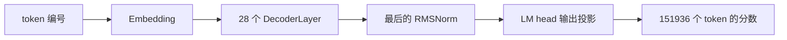
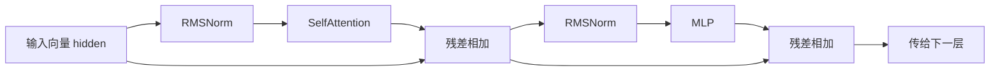

# Qwen 怎样搭积木

打开 `src/model/qwen3.c` 的 `qwen_forward_token()`。其中列出的组件顺序是：

## PyTorch 中熟悉的名称在这里的位置

| PyTorch 中的构件 | C 中的结构与函数 | 文件 |
| --- | --- | --- |
| `nn.Embedding` | `Embedding`、`embedding_forward()` | `src/layers/basic.c` |
| `nn.Linear` | `Linear`、`linear_forward()` | `src/layers/basic.c` |
| `Qwen3RMSNorm` | `RMSNorm`、`rmsnorm_forward()` | `src/layers/basic.c` |
| `Qwen3Attention` | `SelfAttention`、`self_attention_forward()` | `src/layers/self_attention.c` |
| `Qwen3MLP` | `MLP`、`mlp_forward()` | `src/layers/mlp.c` |
| `Qwen3DecoderLayer` | `DecoderLayer`、`decoder_layer_forward()` | `src/layers/decoder_layer.c` |
| 模型的 `forward()` | `qwen_forward_token()` | `src/model/qwen3.c` |
| 自回归生成 | `qwen_generate_turn()` | `src/runtime/generate.c` |

C 中用结构体保存组件参数，用函数描述组件的计算过程。
`include/qwen_layers.h` 列出了这些结构；`QwenModel` 保存 Embedding、28 层、最终归一化和输出投影。

## 一个 DecoderLayer

`decoder_layer.c` 的函数体依次执行两条分支：

残差相加表示逐元素相加。`runtime->hidden` 保存主干向量，`runtime->branch_output`
保存当前 Attention 或 MLP 的结果。`residual_add()` 将这两个数组对应位置的数值相加。
整个过程中，主干向量长度保持 1024。

## 先读 MLP

`mlp.c` 中的输入向量长 1024。`gate_proj` 和 `up_proj` 分别产生 3072 个数。
程序对 gate 的元素应用 SiLU，再与 up 的对应元素相乘，最后交给 `down_proj` 变回 1024 维。

读这个函数时，可以将每次 `linear_forward()` 当成一次 Linear 组件调用。
SiLU 的计算实现位于 `src/ops/math.c`。

## 再读 Attention

`self_attention.c` 按下面的顺序调用组件：

1. Q/K/V 三个 Linear 投影。
2. 每个 Q/K 头各自执行 RMSNorm。
3. RoPE 根据当前 token 的位置处理 Q/K。
4. 将当前 K/V 加入这一层的历史缓存。
5. 当前 Q 与历史 K 做点积，Softmax 得到历史位置的权重，再对 V 做加权求和。
6. `o_proj` 将各个头的拼接结果投影回主干维度。

| 参数 | 当前 Qwen3-0.6B 的数值 |
| --- | ---: |
| 主干向量长度 | 1024 |
| Q 头数 | 16 |
| KV 头数 | 8 |
| 每个头的长度 | 128 |
| Q 投影总长度 | 2048 |
| K/V 各自的总长度 | 1024 |

每两个 Q 头共享一个 KV 头。`head / queries_per_kv_head` 计算当前 Q 头应当使用哪个 KV 头。

缓存保存的是历史 token 的 K/V。处理位置 `position` 时，代码读取从 0 到 `position` 的位置，
因此本次计算只使用当前与过去的信息。

## 从一次 forward 到一段回答

一次 `forward` 更新一个 token 的表示和缓存，并可以输出词表分数。
`generate.c` 反复调用它：处理完提示之后，采样器选择一个 token，再将这个新 token 送入模型。

本项目一次处理一个 token，以适应 PSP 的内存条件。临时数组预先分配在 `QwenRuntime` 中，
所有层重复使用这些数组。模块之间传递的是这些数组的地址。

`need_logits` 控制是否执行最终词表投影。提示的中间 token 更新缓存，最后一个提示 token
需要产生第一个回答 token 的分数。这一设置减少了读取输出投影矩阵的次数。
