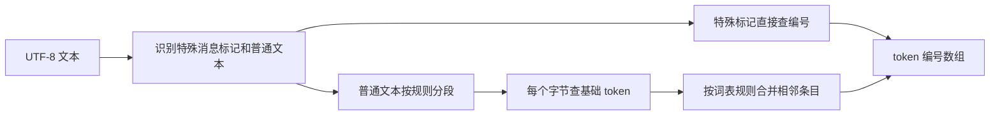

# 用真实词表看 tokenizer

运行 `tokenizer_demo` 后，先看输入文本和最后的编号数组，再逐段查看中间的合并过程。
当前词表中 `Hello world` 的结果是 `[9707, 1879]`。

## 预分词和 BPE 分别处理什么

预分词将 `Hello world` 分为 `Hello` 和 ` world` 两个连续片段。
这一步处理空格、标点、数字、换行和 Unicode 字符的边界。
代码位于 `tokenizer.c` 的 `encode_normal_text()`，具体规则由 PCRE2 执行。

分词代码中的 `chunk` 常用来称呼这样的文本片段。本目录使用名称 `segment`；
`bpe_encode_segment()` 只对传入的一个片段执行合并。

BPE 是 Byte Pair Encoding。当前模型使用字节级 BPE：将片段中的 UTF-8 字节转换成基础
token 条目，然后按照词表已经给出的规则，反复合并相邻条目。推理过程中使用的是固定规则。

## 对 Hello 执行 BPE

下面的数据来自 `build/tokenizer_demo` 对当前真实词表的输出：

| 步骤 | 选择的合并 | 合并优先级 rank | 当前条目 |
| --- | --- | ---: | --- |
| 开始 | 每个字节查词表 | — | `H`、`e`、`l`、`l`、`o` |
| 1 | `e` 与 `l` | 45 | `H`、`el`、`l`、`o` |
| 2 | `l` 与 `o` | 129 | `H`、`el`、`lo` |
| 3 | `el` 与 `lo` | 4535 | `H`、`ello` |
| 4 | `H` 与 `ello` | 9451 | `Hello` |

最后的 `Hello` 对应编号 `9707`。每轮都检查当前所有相邻条目，在可用合并中选择 rank 最小的一项。
两个条目可以合并，取决于词表和合并规则；词表中的 token 编号和合并 rank 各自有自己的用途。

`bpe.c` 里的循环对应四个动作：

1. 查看当前相邻条目，将它们的字节临时拼接。
2. 调用 `vocabulary_find()` 查找拼接内容对应的条目。
3. 读取该条目的合并 rank，保留本轮最优先的一项。
4. 执行一次合并，减少条目数量，再开始下一轮。

当没有可用合并，或者只剩一个条目时，循环结束。

## 中文为什么出现字节

`你好` 的 UTF-8 字节依次为 `E4 BD A0 E5 A5 BD`。
演示用 `\xE4` 这样的形式显示单独字节，随后可以看到它们合并成“你”、“好”，
最终合并成词表中的“你好”，编号为 `108386`。

一个中文字符占几个 UTF-8 字节，与它最后由几个 token 表示，分别由编码方式和词表决定。
`tokenizer_token_bytes()` 根据一个 token 编号返回它对应的字节；将生成的 token 字节依次拼接，
就得到输出文本。

## 消息标记与聊天模板

`<|im_start|>` 等标记用于表示消息角色与起止位置。它们有固定编号，
`vocabulary_special_at()` 会识别这些条目。

`chat_template.c` 将用户文本放入 user 消息，随后追加 assistant 消息的前缀。
它对应官方模板的 `enable_thinking=False`，也使用同一套 tokenizer 编码普通文本。

| 需要寻找的代码 | 文件和函数 |
| --- | --- |
| 整个编码过程 | `tokenizer.c`：`tokenizer_encode_with_trace()` |
| 普通文本的预分词 | `tokenizer.c`：`encode_normal_text()` |
| 一段文本的 BPE 合并 | `bpe.c`：`bpe_encode_segment()` |
| 按字节查词表、按编号查字节 | `vocabulary.c` |
| 用户消息和 assistant 前缀 | `chat_template.c` |
| 逐步演示的输出 | `app/tokenizer_demo.c`：`observe()` |

演示和模型生成调用同一份编码实现。观察函数在合并期间打印真实状态。
